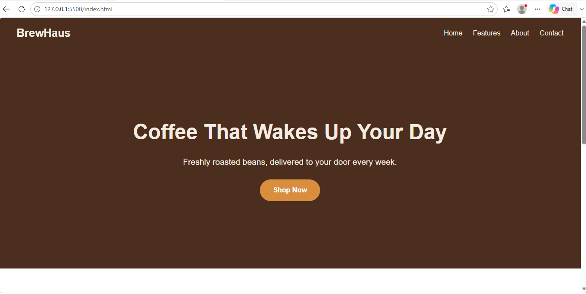
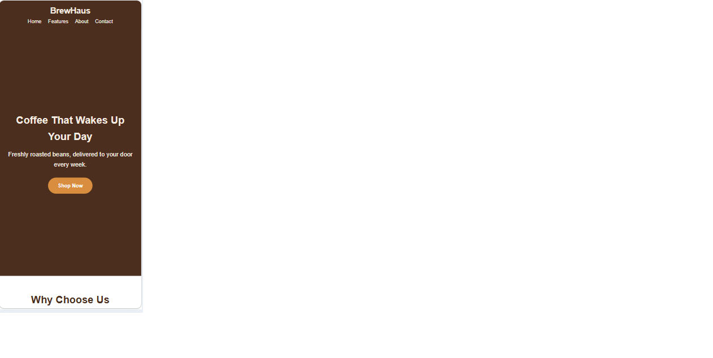

# BrewHaus Landing Page

A responsive static landing page for a fictional coffee brand, built as part of the Oasis Infobyte Web Development & Designing internship (Level 1, Task 1).

## Features
- Sticky navigation bar with 4 links
- Hero section with headline, subheadline and call-to-action button
- Features and About sections
- Footer with contact and social placeholder links
- Consistent colour palette and clean typography
- Responsive layout using CSS Flexbox and Grid

## Tech Stack
HTML5, CSS3

## How to Run
Download the folder and open `index.html` in any browser.

## Screenshots

## Author
Francis Odhiambo
