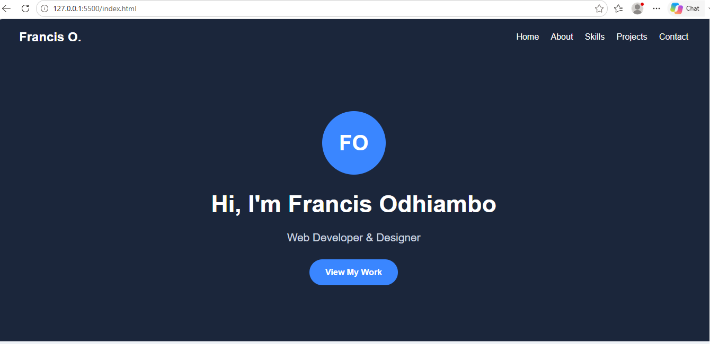
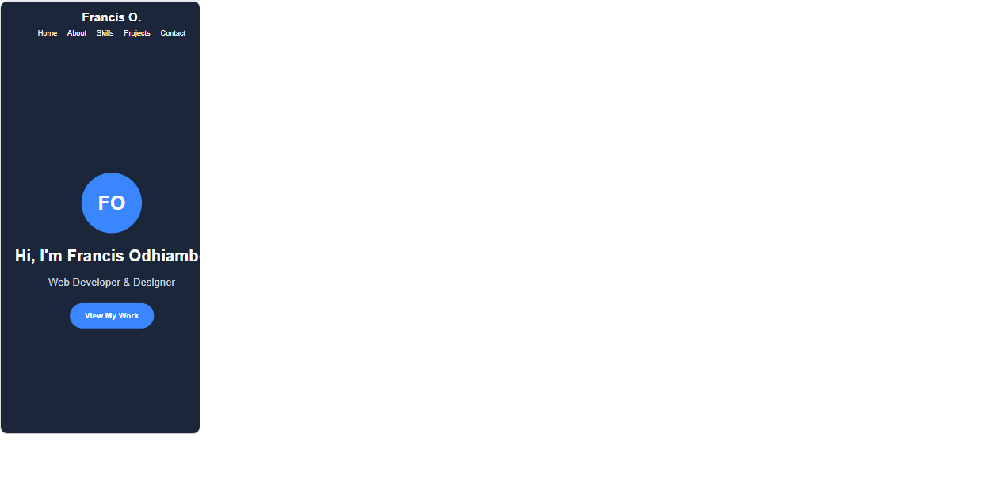

# Personal Portfolio

A responsive personal portfolio website showcasing my profile, skills, projects and contact details. Built for the Oasis Infobyte Web Development & Designing internship (Level 1, Task 2).

## Features
- Hero section with name, role and avatar
- About Me, Skills, Projects and Contact sections
- Smooth scrolling navigation
- Consistent colour scheme and font throughout
- Fully responsive on desktop and mobile

## Tech Stack
HTML5, CSS3

## How to Run
Download the folder and open `index.html` in any browser.

## Screenshots

## Author
Francis Odhiambo
