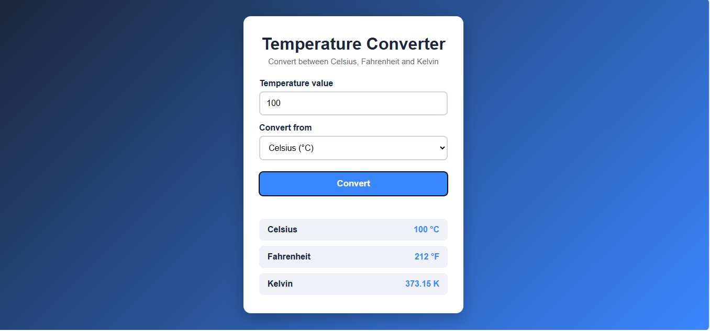

# Temperature Converter

An interactive web tool that converts temperatures between Celsius, Fahrenheit and Kelvin. Built for the Oasis Infobyte Web Development & Designing internship (Level 1, Task 3).

## Features
- Numeric input with validation (rejects empty or non-numeric input)
- Unit selector for Celsius, Fahrenheit or Kelvin
- Convert button (also works with the Enter key)
- Shows all three units at once with correct labels
- Absolute zero check with a friendly error message

## Conversion Formulas
- C to F: (C × 9/5) + 32
- F to C: (F − 32) × 5/9
- C to K: C + 273.15

## Tech Stack
HTML5, CSS3, Vanilla JavaScript

## How to Run
Download the folder and open `index.html` in any browser.

## Screenshots

## Author
Francis Odhiambo
